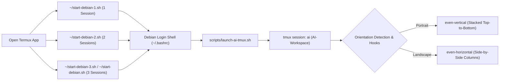

# toolz — Termux + Andronix Debian Multi-Session AI Workspace

Automated multi-agent terminal workspace for **Termux + Andronix Debian (`proot`)** on Android. Includes dedicated `start-debian` launcher scripts to launch **1, 2, or 3 AI sessions** in an orientation-aware (non-overlapping) `tmux` workspace:

- **[`scripts/start-debian-1.sh`](scripts/start-debian-1.sh)** (**1 Session**):
  - **Pane 0**: **Antigravity CLI** (`agy` / `antigravity`)
- **[`scripts/start-debian-2.sh`](scripts/start-debian-2.sh)** (**2 Sessions**):
  - **Pane 0 (Top / Left)**: **Antigravity CLI** (`agy`)
  - **Pane 1 (Bottom / Right)**: **OpenAI Codex CLI** (`codex --no-daemon`)
- **[`scripts/start-debian-3.sh`](scripts/start-debian-3.sh)** & **[`scripts/start-debian.sh`](scripts/start-debian.sh)** (**3 Sessions**):
  - **Pane 0 (Top / Left)**: **Antigravity CLI** (`agy`)
  - **Pane 1 (Middle)**: **OpenAI Codex CLI** (`codex --no-daemon`)
  - **Pane 2 (Bottom / Right)**: **Google Jules CLI** (`jules`)

---

## Visual Layout (Portrait vs. Landscape)

Unlike standard `tmux new-window` tabs that hide inactive agents in background windows, `launch-ai-tmux.sh` splits a single workspace window (`AI-Workspace`) into **1, 2, or 3 panes** with touch/mouse support and top title borders, automatically adapting to your screen's orientation and dynamically restacking whenever you rotate your device:

### Portrait Orientation (`even-vertical` — Stacked Top-to-Bottom)
When in **portrait** mode, the active sessions (1, 2, or 3) are stacked vertically on top of each other so every agent gets the full screen width:

```text
┌─────────────────────────────────────────────────────────┐
│ 0: Antigravity (agy)                                    │
├─────────────────────────────────────────────────────────┤
│  Antigravity CLI (agy)                                  │
│  > _                                                    │
├─────────────────────────────────────────────────────────┤
│ 1: Codex (codex)                                        │
├─────────────────────────────────────────────────────────┤
│  OpenAI Codex CLI (codex --no-daemon)                   │
│  › Ask Codex to do anything                             │
├─────────────────────────────────────────────────────────┤
│ 2: Jules (jules)                                        │
├─────────────────────────────────────────────────────────┤
│  Google Jules CLI (jules)                               │
│  Working in: /home/b                                    │
└─────────────────────────────────────────────────────────┘
 [ai] 0:AI-Workspace*
```

### Landscape Orientation (`even-horizontal` — Side-by-Side Columns)
When rotated to **landscape** mode, the active sessions automatically arrange into equal side-by-side columns:

```text
┌───────────────────┬───────────────────┬───────────────────┐
│ 0: Antigravity    │ 1: Codex          │ 2: Jules          │
├───────────────────┼───────────────────┼───────────────────┤
│                   │                   │                   │
│  Antigravity CLI  │  OpenAI Codex CLI │  Google Jules CLI │
│  (agy)            │  (codex)          │  (jules)          │
│                   │                   │                   │
│  > _              │  › Ask Codex...   │  Working in: ~    │
│                   │                   │                   │
└───────────────────┴───────────────────┴───────────────────┘
 [ai] 0:AI-Workspace*
```

---

## Architecture & Startup Flow



---

## Repository Structure

| Path | Description |
| :--- | :--- |
| [`scripts/start-debian-1.sh`](scripts/start-debian-1.sh) | Launches Debian and opens **1 AI session** (`Pane 0: Antigravity`). |
| [`scripts/start-debian-2.sh`](scripts/start-debian-2.sh) | Launches Debian and opens **2 AI sessions** (`Pane 0: Antigravity`, `Pane 1: Codex`), stacked in portrait or side-by-side in landscape. |
| [`scripts/start-debian-3.sh`](scripts/start-debian-3.sh) | Launches Debian and opens **3 AI sessions** (`Pane 0: Antigravity`, `Pane 1: Codex`, `Pane 2: Jules`), stacked in portrait or side-by-side in landscape. |
| [`scripts/start-debian.sh`](scripts/start-debian.sh) | Unified Andronix Debian + AI workspace launcher supporting `--sessions 1\|2\|3` (`-1`, `-2`, `-3`), defaulting to 3 sessions. |
| [`.shortcut/`](.shortcut) & [`.shortcuts/`](.shortcuts) | Pre-built Termux shortcut directories containing `start-debian-1.sh`, `start-debian-2.sh`, `start-debian-3.sh`, and `start-debian.sh` for `~/.shortcut` / `~/.shortcuts` (Termux:Widget). |
| [`scripts/launch-ai-tmux.sh`](scripts/launch-ai-tmux.sh) | Core `tmux` workspace manager that creates or dynamically scales `ai:AI-Workspace` between 1, 2, or 3 panes, detects portrait (`even-vertical`) vs. landscape (`even-horizontal`) orientation, and registers dynamic resize hooks. |
| [`scripts/install-autostart.sh`](scripts/install-autostart.sh) | Idempotent setup script that installs `tmux`, configures `/usr/local/bin` and `~/` symlinks, populates `~/.shortcut/` and `~/.shortcuts/`, exports scripts to `/sdcard/Download`, and registers the auto-launch hook in `~/.bashrc`. |
| [`tests/test-launch-ai-tmux.sh`](tests/test-launch-ai-tmux.sh) | Automated integration and unit test suite verifying 1-, 2-, and 3-session launchers, `.shortcut` scripts, dynamic scaling, portrait vertical stacking, landscape side-by-side columns, rotation hooks, and zoom preservation. |
| [`docs/Home.md`](docs/Home.md) | Wiki home page and documentation index. |
| [`docs/Installation-and-Setup.md`](docs/Installation-and-Setup.md) | Complete step-by-step installation guide for both Debian and outer Termux. |
| [`docs/Architecture-and-How-It-Works.md`](docs/Architecture-and-How-It-Works.md) | Technical deep-dive into `proot` process management, `codex --no-daemon`, portrait/landscape detection, and `tmux` geometry hooks. |
| [`docs/Usage-and-Shortcuts.md`](docs/Usage-and-Shortcuts.md) | Touch navigation, pane resizing, zooming, session count & orientation flags, environment variables, and keyboard shortcuts. |
| [`docs/Troubleshooting.md`](docs/Troubleshooting.md) | Solutions for common `dpkg`, `proot`, `PATH`, orientation, and `tmux` issues. |

---

## Quick Start & Installation

### 1. Clone and Run the Installer Inside Debian

From inside your Andronix Debian shell (after running `~/start-debian.sh` in Termux):

```bash
git clone https://github.com/bmifsud/toolz.git ~/toolz
cd ~/toolz
chmod +x scripts/*.sh
./scripts/install-autostart.sh
```

What `install-autostart.sh` does automatically:
- Repairs any interrupted `dpkg` state and installs `tmux` if not already installed.
- Creates global symlinks in `/usr/local/bin` and `~/` (`start-debian-1.sh`, `start-debian-2.sh`, `start-debian-3.sh`, `start-debian.sh`, `launch-ai-tmux.sh`, `agy`, `antigravity`, `codex`).
- Populates `~/.shortcut/`, `~/.shortcuts/`, `/sdcard/Download/.shortcut/`, and `/sdcard/Download/.shortcuts/` with `start-debian-1.sh`, `start-debian-2.sh`, `start-debian-3.sh`, and `start-debian.sh`.
- Adds a loop-guarded auto-launch block to `~/.bashrc` so entering Debian automatically opens the AI workspace.

### 2. Install `start-debian-{1,2,3}.sh` into Outer Termux (`~/.shortcut` & `~/`)

Run this command inside your **outer Termux shell** (outside Debian) to install `start-debian-1.sh`, `start-debian-2.sh`, `start-debian-3.sh`, and `start-debian.sh` into Termux's `~/`, `~/.shortcut/`, and `~/.shortcuts/` directories:

```bash
~/.andronix/distros/debian/rootfs/home/b/toolz/scripts/install-autostart.sh
```

Now from outer Termux (or inside Debian) you can launch 1, 2, or 3 sessions directly:

```bash
~/start-debian-1.sh   # Launch Debian with 1 session  (Antigravity)
~/start-debian-2.sh   # Launch Debian with 2 sessions (Antigravity + Codex)
~/start-debian-3.sh   # Launch Debian with 3 sessions (Antigravity + Codex + Jules)
```

---

## Usage

### Launching 1, 2, or 3 Sessions
You can launch or dynamically resize an already-running workspace between 1, 2, and 3 sessions at any time without losing your active `Antigravity` session:

```bash
# Launch or scale to 1 session (Antigravity only):
start-debian-1.sh
# or: launch-ai-tmux.sh --sessions 1

# Launch or scale to 2 sessions (Antigravity + Codex):
start-debian-2.sh
# or: launch-ai-tmux.sh --sessions 2

# Launch or scale to 3 sessions (Antigravity + Codex + Jules):
start-debian-3.sh
# or: launch-ai-tmux.sh --sessions 3
```

### Orientation Control (Portrait vs. Landscape)
- **In Portrait**: Active sessions automatically stack vertically on top of each other (`even-vertical`).
- **In Landscape**: Active sessions automatically sit side-by-side (`even-horizontal`).
- **Rotating Your Device**: `tmux` `client-resized` and `window-resized` hooks automatically restack or unstack the panes in real time whenever you rotate between portrait and landscape.

```bash
# Force portrait layout (stack sessions on top of each other):
start-debian-2.sh --portrait
start-debian-3.sh --portrait

# Force landscape layout (side-by-side columns):
start-debian-2.sh --landscape
start-debian-3.sh --landscape
```

### Running the Automated Test Suite
```bash
./tests/test-launch-ai-tmux.sh
```

### Bypassing Auto-Launch for a Single Shell
To open a plain Debian shell without auto-attaching to `tmux`:

```bash
SKIP_AI_TMUX=1 bash
```

---

## Touch & Keyboard Controls

Because `mouse on` is enabled in the `ai` session, you can interact with the panes directly on your Android touchscreen:

- **Switch active agent pane**: Tap anywhere inside **Pane 0 (`Antigravity`)**, **Pane 1 (`Codex`)**, or **Pane 2 (`Jules`)** — or press `Ctrl+b` followed by `Up` / `Down` (portrait) or `Left` / `Right` (landscape) arrow keys.
- **Resize panes**: Drag the horizontal border (portrait) or vertical border (landscape) between panes with your finger.
- **Full-screen zoom a single pane (toggle)**: Press `Ctrl+b` then `z` to temporarily expand the active pane to full screen; press `Ctrl+b` then `z` again to restore the multi-pane view.
- **Manually cycle layout**: Press `Ctrl+b` then `Space` to manually cycle pane layouts.
- **Detach from workspace (keep agents running in background)**: Press `Ctrl+b` then `d`.

---

## Environment Variables

| Variable | Default | Description |
| :--- | :--- | :--- |
| `AI_SESSION_COUNT` | `3` (or `~/.ai_session_count`) | Number of sessions/panes to launch (`1`, `2`, or `3`). |
| `AI_ORIENTATION` | `auto` | Orientation mode: `auto` (dynamic portrait/landscape switching), `portrait` (always stack vertically), or `landscape` (always side-by-side). |
| `AI_MIN_LANDSCAPE_COLS` | `115` | Minimum column width required to switch to side-by-side columns in `auto` mode. Keeps portrait mode stacked vertically even when the Android soft keyboard shrinks terminal height. |
| `AI_SESSION_NAME` | `ai` | Name of the `tmux` session created/attached by `launch-ai-tmux.sh`. |
| `AI_WORKDIR` | `$HOME` (`/home/b`) | Initial working directory for all agent panes. |
| `DEBIAN_LAUNCHER` | `~/start-debian.sh` (or `~/start_debian.sh`) | Path to custom Andronix Debian startup script when invoked from outer Termux. |
| `SKIP_AI_TMUX` | *(unset)* | Set to `1` to skip auto-launching `launch-ai-tmux.sh` from `~/.bashrc`. |

---

## Wiki & Detailed Documentation

For deeper technical details, see the [`docs/`](docs/Home.md) directory:
- [**Wiki Home**](docs/Home.md)
- [**Installation & Setup Guide**](docs/Installation-and-Setup.md)
- [**Architecture & How It Works**](docs/Architecture-and-How-It-Works.md)
- [**Usage, Touch Gestures & Shortcuts**](docs/Usage-and-Shortcuts.md)
- [**Troubleshooting Guide**](docs/Troubleshooting.md)

---

## Encrypted Backups, Scheduling & Recovery

The [`backup/`](backup/) directory contains a two-tier backup implementation for OmniRoute/Cline and Classic Andronix Debian. These backups are **separate from** the tmux/AI workspace launcher.

| Component | Purpose | Documentation |
| --- | --- | --- |
| Tier-1 — OmniRoute and Cline | Encrypted application state, SQLite hot backup and Google Drive sync | [Backup README](backup/README.md) |
| Tier-2 — Classic Andronix Debian | Encrypted rootfs snapshot and recovery (Termux host) | [Tier-2 guide](backup/TIER2_README.md) |
| Automated scheduling | Tier-1 at 09:00 and 21:00 daily; Tier-2 at 03:00 Monday, Wednesday and Friday | [Scheduling guide](backup/SCHEDULING.md) |
| Regression testing | Isolated shell syntax, snapshot, encryption, restore and scheduler tests | [Test runner](backup/test_full_flow.sh) |

### Run the backup regression tests

From the repository root, in a compatible Linux environment with Python, pytest, GPG and rclone installed:

```bash
bash backup/test_full_flow.sh
```

The [backup regression GitHub Actions workflow](.github/workflows/backup-regression.yml) is configured to run on relevant pushes and pull requests. **The expanded test suite and workflow have not yet been confirmed passing**, and 100% measured code coverage has **not** been established.

### Before enabling unattended cron

Read the [scheduling guide](backup/SCHEDULING.md) and verify the Debian launcher, GPG passphrase-file permissions, `gdrive:` remote, cloud comparison, and disposable restore. Tier-2 currently **skips** if Debian PRoot is active and requires a recent preflight readiness marker; it is **not fully unattended**. Existing Tier-1 scripts remain unchanged. Do not rely on these backups as your only recovery mechanism until real-device acceptance testing succeeds.
