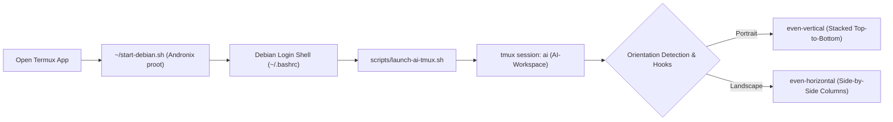

# toolz — Termux + Andronix Debian 3-Pane AI Workspace

Automated multi-agent terminal workspace for **Termux + Andronix Debian (`proot`)** on Android. Launching Debian automatically opens a **3-pane orientation-aware (non-overlapping) `tmux` workspace** running three AI coding assistants simultaneously:

1. **Pane 0 (Top in Portrait / Left in Landscape)**: **Antigravity CLI** (`agy` / `antigravity`)
2. **Pane 1 (Middle)**: **OpenAI Codex CLI** (`codex --no-daemon`)
3. **Pane 2 (Bottom in Portrait / Right in Landscape)**: **Google Jules CLI** (`jules`)

---

## Visual Layout (Portrait vs. Landscape)

Unlike standard `tmux new-window` tabs that hide inactive agents in background windows, `launch-ai-tmux.sh` splits a single workspace window (`AI-Workspace`) with touch/mouse support and top title borders, automatically adapting to your screen's orientation and dynamically restacking whenever you rotate your device:

### Portrait Orientation (`even-vertical` — Stacked Top-to-Bottom)
When in **portrait** mode, the 3 sessions are stacked vertically on top of each other so every agent gets the full screen width:

```text
┌─────────────────────────────────────────────────────────┐
│ 0: Antigravity (agy)                                    │
├─────────────────────────────────────────────────────────┤
│  Antigravity CLI (agy)                                  │
│  > _                                                    │
├─────────────────────────────────────────────────────────┤
│ 1: Codex (codex)                                        │
├─────────────────────────────────────────────────────────┤
│  OpenAI Codex CLI (codex --no-daemon)                   │
│  › Ask Codex to do anything                             │
├─────────────────────────────────────────────────────────┤
│ 2: Jules (jules)                                        │
├─────────────────────────────────────────────────────────┤
│  Google Jules CLI (jules)                               │
│  Working in: /home/b                                    │
└─────────────────────────────────────────────────────────┘
 [ai] 0:AI-Workspace*
```

### Landscape Orientation (`even-horizontal` — Side-by-Side Columns)
When rotated to **landscape** mode, the 3 sessions automatically arrange into equal side-by-side columns:

```text
┌───────────────────┬───────────────────┬───────────────────┐
│ 0: Antigravity    │ 1: Codex          │ 2: Jules          │
├───────────────────┼───────────────────┼───────────────────┤
│                   │                   │                   │
│  Antigravity CLI  │  OpenAI Codex CLI │  Google Jules CLI │
│  (agy)            │  (codex)          │  (jules)          │
│                   │                   │                   │
│  > _              │  › Ask Codex...   │  Working in: ~    │
│                   │                   │                   │
└───────────────────┴───────────────────┴───────────────────┘
 [ai] 0:AI-Workspace*
```

---

## Architecture & Startup Flow



---

## Repository Structure

| Path | Description |
| :--- | :--- |
| [`scripts/launch-ai-tmux.sh`](scripts/launch-ai-tmux.sh) | Core launcher script that detects outer Termux vs. Debian `proot`, creates the 3-pane `tmux` session (`ai`), detects portrait (`even-vertical`) vs. landscape (`even-horizontal`) orientation, registers dynamic resize hooks, enables touch/mouse mode, and launches `agy`, `codex --no-daemon`, and `jules`. |
| [`scripts/install-autostart.sh`](scripts/install-autostart.sh) | Idempotent setup script that installs `tmux`, configures `/usr/local/bin` symlinks (`agy`, `antigravity`, `codex`, `launch-ai-tmux.sh`), and registers the auto-launch hook in `~/.bashrc`. |
| [`docs/Home.md`](docs/Home.md) | Wiki home page and documentation index. |
| [`docs/Installation-and-Setup.md`](docs/Installation-and-Setup.md) | Complete step-by-step installation guide for both Debian and outer Termux. |
| [`docs/Architecture-and-How-It-Works.md`](docs/Architecture-and-How-It-Works.md) | Technical deep-dive into `proot` process management, `codex --no-daemon`, portrait/landscape detection, and `tmux` geometry hooks. |
| [`docs/Usage-and-Shortcuts.md`](docs/Usage-and-Shortcuts.md) | Touch navigation, pane resizing, zooming, orientation flags, environment variables, and keyboard shortcuts. |
| [`docs/Troubleshooting.md`](docs/Troubleshooting.md) | Solutions for common `dpkg`, `proot`, `PATH`, orientation, and `tmux` issues. |

---

## Quick Start & Installation

### 1. Clone and Run the Installer Inside Debian

From inside your Andronix Debian shell (after running `~/start-debian.sh` in Termux):

```bash
git clone https://github.com/bmifsud/toolz.git ~/toolz
cd ~/toolz
chmod +x scripts/*.sh
./scripts/install-autostart.sh
```

What `install-autostart.sh` does automatically:
- Repairs any interrupted `dpkg` state and installs `tmux` if not already installed.
- Creates global symlinks in `/usr/local/bin` (`agy`, `antigravity`, `codex`, `launch-ai-tmux.sh`) so all tools are found in `PATH` across login and non-login shells.
- Adds a loop-guarded auto-launch block to `~/.bashrc` so entering Debian via `start-debian.sh` automatically opens the 3-pane AI workspace.

### 2. Enable Auto-Start in Outer Termux (Optional)

If you want opening the **Termux** app on Android to immediately enter Debian and launch the 3-pane workspace without typing `./start-debian.sh`, run this once in an **outer Termux shell** (outside Debian):

```bash
grep -q "start-debian.sh" ~/.bashrc 2>/dev/null || \
  echo '[ -z "$DEBIAN_STARTED" ] && export DEBIAN_STARTED=1 && exec ~/start-debian.sh' >> ~/.bashrc
```

---

## Usage

### Automatic Launch & Dynamic Rotation
Every time you start a new interactive Debian session via `~/start-debian.sh`, `~/.bashrc` invokes `launch-ai-tmux.sh` and attaches to the `ai` session.
- **In Portrait**: Sessions automatically stack vertically on top of each other (`even-vertical`).
- **In Landscape**: Sessions automatically sit side-by-side (`even-horizontal`).
- **Rotating Your Device**: `tmux` `client-resized` and `window-resized` hooks automatically restack or unstack the panes in real time whenever you rotate between portrait and landscape.

### Manual Launch & Orientation Overrides
You can also run the launcher manually from either Termux or Debian, or lock a specific orientation:

```bash
# Auto-detect portrait vs. landscape (default):
launch-ai-tmux.sh

# Force portrait layout (stack all 3 sessions vertically on top of each other):
launch-ai-tmux.sh --portrait

# Force landscape layout (3 side-by-side columns):
launch-ai-tmux.sh --landscape

# Pre-create/update the session in the background without attaching:
launch-ai-tmux.sh --no-attach
launch-ai-tmux.sh --portrait --no-attach
```

### Bypassing Auto-Launch for a Single Shell
To open a plain Debian shell without auto-attaching to `tmux`:

```bash
SKIP_AI_TMUX=1 bash
```

---

## Touch & Keyboard Controls

Because `mouse on` is enabled in the `ai` session, you can interact with the 3 panes directly on your Android touchscreen:

- **Switch active agent pane**: Tap anywhere inside **Pane 0 (`Antigravity`)**, **Pane 1 (`Codex`)**, or **Pane 2 (`Jules`)** — or press `Ctrl+b` followed by `Up` / `Down` (portrait) or `Left` / `Right` (landscape) arrow keys.
- **Resize panes**: Drag the horizontal border (portrait) or vertical border (landscape) between panes with your finger.
- **Full-screen zoom a single pane (toggle)**: Press `Ctrl+b` then `z` to temporarily expand the active pane to full screen; press `Ctrl+b` then `z` again to restore the 3-pane view.
- **Manually cycle layout**: Press `Ctrl+b` then `Space` to manually cycle pane layouts.
- **Detach from workspace (keep agents running in background)**: Press `Ctrl+b` then `d`.

---

## Environment Variables

| Variable | Default | Description |
| :--- | :--- | :--- |
| `DEBIAN_LAUNCHER` | `~/start-debian.sh` (or `~/start_debian.sh`) | Path to the Andronix Debian startup script when invoked from outer Termux. |
| `AI_SESSION_NAME` | `ai` | Name of the `tmux` session created/attached by `launch-ai-tmux.sh`. |
| `AI_WORKDIR` | `$HOME` (`/home/b`) | Initial working directory for all 3 agent panes. |
| `AI_ORIENTATION` | `auto` | Orientation mode: `auto` (dynamic portrait/landscape switching), `portrait` (always stack vertically), or `landscape` (always side-by-side). |
| `AI_MIN_LANDSCAPE_COLS` | `115` | Minimum column width required to switch to 3 side-by-side columns in `auto` mode. Keeps portrait mode stacked vertically even when the Android soft keyboard shrinks terminal height. |
| `SKIP_AI_TMUX` | *(unset)* | Set to `1` to skip auto-launching `launch-ai-tmux.sh` from `~/.bashrc`. |

---

## Wiki & Detailed Documentation

For deeper technical details, see the [`docs/`](docs/Home.md) directory:
- [**Wiki Home**](docs/Home.md)
- [**Installation & Setup Guide**](docs/Installation-and-Setup.md)
- [**Architecture & How It Works**](docs/Architecture-and-How-It-Works.md)
- [**Usage, Touch Gestures & Shortcuts**](docs/Usage-and-Shortcuts.md)
- [**Troubleshooting Guide**](docs/Troubleshooting.md)
