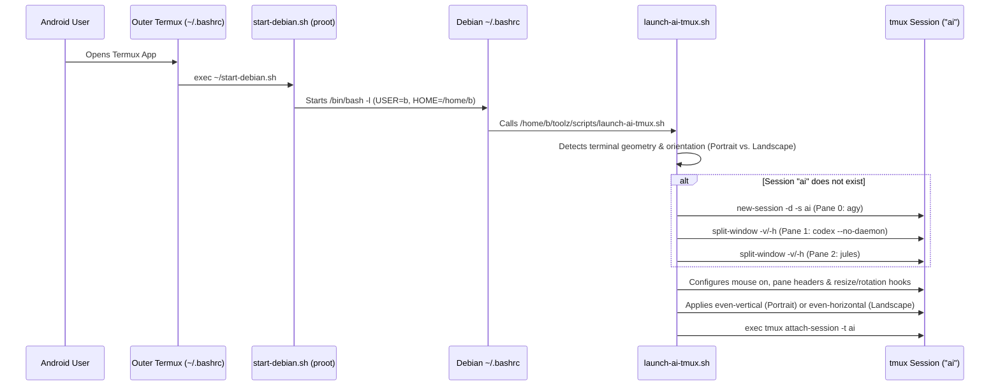

# Architecture & How It Works

This document explains the internal design of [`scripts/launch-ai-tmux.sh`](../scripts/launch-ai-tmux.sh) and [`scripts/install-autostart.sh`](../scripts/install-autostart.sh), and why specific technical choices were made for the **Termux + Andronix Debian (`proot`)** environment.

---

## 1. End-to-End Execution Pipeline



---

## 2. Key Engineering Decisions

### A. Single `proot` + 3 `tmux` Panes vs. 3 Separate `proot` Processes
Andronix's `start-debian.sh` launches Debian using `proot` (user-space `chroot` via `ptrace`/syscall translation) alongside a `pulseaudio` server.
- Launching 3 separate Termux sessions that each run `start-debian.sh` spawns **3 independent `proot` instances and 3 `pulseaudio` daemons**, increasing memory usage and syscall translation overhead.
- Running `tmux` **inside** a single Debian `proot` session and splitting the window into 3 panes runs all 3 AI tools under one `proot` supervisor and displays all 3 simultaneously.
- Additionally, because Andronix's default `start-debian.sh` ends with `/bin/bash -l` and does **not** forward extra CLI arguments (`-- ...`) into Debian without manual script edits, triggering `launch-ai-tmux.sh` from Debian's `~/.bashrc` works out of the box with an unmodified `start-debian.sh`.

### B. Orientation-Aware Layout: Stacked in Portrait (`even-vertical`) vs. Side-by-Side in Landscape (`even-horizontal`)
- Using `tmux new-window` creates multiple background windows (tabs) where only one CLI is visible on screen at a time.
- Instead, `launch-ai-tmux.sh` creates a single window (`AI-Workspace`) with 3 panes (`0: Antigravity`, `1: Codex`, `2: Jules`) and adapts the layout to the screen orientation:
  - **Portrait Orientation (`even-vertical`)**: Stacks all 3 sessions vertically on top of each other (Pane 0 at the top, Pane 1 in the middle, Pane 2 at the bottom) so each agent receives the full terminal column width.
  - **Landscape Orientation (`even-horizontal`)**: Arranges all 3 sessions side-by-side in equal horizontal columns (Pane 0 on the left, Pane 1 in the middle, Pane 2 on the right).
- **How Portrait vs. Landscape Is Detected**:
  1. **Aspect Ratio in Character Cells**: Monospace terminal character cells in Termux have an ~`1:2` width-to-height pixel ratio (e.g., `13px × 26px`). Therefore, `window_width < window_height * 2` directly corresponds to a portrait pixel viewport (`pixel_width < pixel_height`).
  2. **Android Soft-Keyboard Resilience (`AI_MIN_LANDSCAPE_COLS`, default `115`)**: When the Android on-screen keyboard pops up while holding the phone in portrait orientation, `window_height` shrinks while `window_width` remains at the portrait column width (typically `50–105` columns). By treating `window_width < 115` as portrait as well, opening the on-screen keyboard in portrait mode keeps the 3 panes vertically stacked (`even-vertical`) and evenly re-balances their heights instead of accidentally flipping to 3 cramped columns.
  3. **Dynamic `tmux` Rotation Hooks**: `launch-ai-tmux.sh` registers `client-attached`, `client-resized`, and `window-resized` hooks on the `ai` session. Whenever you rotate your Android device between portrait and landscape, `tmux` automatically re-evaluates the window geometry and switches between `even-vertical` (stacked) and `even-horizontal` (side-by-side) — while checking `#{==:#{window_zoomed_flag},0}` so a manually zoomed pane (`Ctrl+b z`) is never unzoomed unexpectedly.

### C. Why `codex --no-daemon` Is Used Inside `proot`
By default, the OpenAI Codex CLI attempts to spawn and connect to a background daemon over a Unix domain socket (`~/.codex/app-server-control/app-server-control.sock`).
Inside Android `proot` environments, stale or cross-session Unix domain sockets in `~/.codex/` can fail with:
```text
failed to connect to /home/b/.codex/app-server-control/app-server-control.sock: No such file or directory (os error 2)
To work without the background server, rerun the same command with --no-daemon
```
Passing `codex --no-daemon` in Pane 1 runs Codex directly in-process, completely avoiding socket failures inside `proot`.

### D. `agy` vs. `antigravity` Binary Naming
The Antigravity CLI installer places the executable at `~/.local/bin/agy` (not `antigravity`). To ensure compatibility with scripts or users expecting either command name:
- `launch-ai-tmux.sh` invokes `agy` directly and prepends `$HOME/.local/bin:/usr/local/bin` to `PATH`.
- `install-autostart.sh` creates symlinks for both `/usr/local/bin/agy` and `/usr/local/bin/antigravity`.

### E. Loop-Prevention Guards in `~/.bashrc`
To guarantee that `~/.bashrc` never triggers recursive `tmux` launches or interferes with background agent commands, the auto-start hook checks five conditions before launching:
1. `[[ $- == *i* ]]` — Must be an interactive shell (ignores non-interactive subshells and scripts).
2. `[[ -z "${TMUX:-}" ]]` — Must not already be inside a `tmux` pane.
3. `[[ -z "${AI_TMUX_AUTO_LAUNCHED:-}" ]]` — Ensures that if you detach from `tmux` (`Ctrl+b d`), your parent shell does not re-launch `tmux` again.
4. `[[ -z "${ANTIGRAVITY_AGENT:-}" ]]` — Prevents tool-execution subshells spawned by Antigravity from triggering `tmux`.
5. `[[ -z "${SKIP_AI_TMUX:-}" ]]` — Allows manual opt-out via `SKIP_AI_TMUX=1`.
